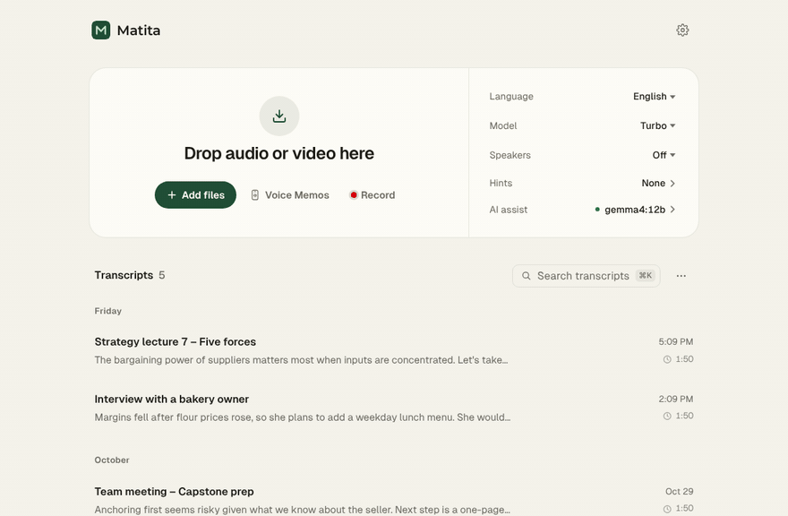
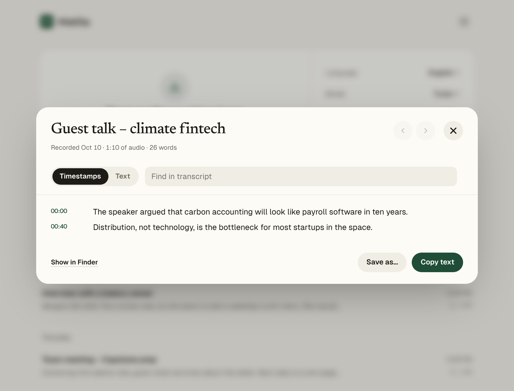

<p align="center">
  
</p>

<h1 align="center">Matita Transcriber</h1>

<p align="center">
  <b>Turn lectures, interviews, meetings and calls into text, summaries and notes. Entirely on your Mac, for free.</b><br>
  <i>Matita</i> is Italian for "pencil": it listens to your recordings and writes them down.
</p>

<p align="center">
  <a href="https://github.com/joonkiee/matita-transcriber/releases/latest"><b>⬇ Download for Mac</b></a> ·
  <a href="https://joonkiee.github.io/matita-transcriber/">Website</a> ·
  Apple Silicon · macOS 14+ · MIT licence
</p>

<p align="center">
  
</p>

## Why Matita

- **Nothing leaves your Mac.** Transcription ([whisper.cpp](https://github.com/ggml-org/whisper.cpp) or NVIDIA Parakeet), speaker names and even AI summaries (with [Ollama](https://ollama.com)) run locally.
- **Free and unlimited.** No account, no subscription, no minute caps.
- **Your files stay files.** Transcripts are plain `.txt` and `.srt` in a folder you choose, with optional Obsidian notes. Delete the app and they're still there.
- **It does the filing for you.** iPhone Voice Memos, watched folders (an SD card, Zoom's recordings) and in-app recording, including the other people in a call, are transcribed, summarised and named on their own.
- **Fast on Apple Silicon.** An hour of audio takes a few minutes.

### How it compares

| | **Matita** | MacWhisper | Otter / Granola |
|---|---|---|---|
| Where your audio is processed | On your Mac | On your Mac | Their servers |
| AI summaries | On your Mac (Ollama) or Claude, your choice | With an AI service you connect | In their cloud |
| Cost | Free | Free tier + paid Pro | Free tier + subscription |
| Where transcripts live | Plain files in your folder, Obsidian notes | Exports | In their app |
| Automatic intake | Voice Memos, watch folders, call recording | Watch folders, meeting recording | Meetings they join or record |
| Open source | Yes (MIT) | No | No |

<details><summary><b>All features</b></summary>

- **Private.** Audio never leaves your Mac. Transcription runs locally with [whisper.cpp](https://github.com/ggml-org/whisper.cpp), the fast C++ version of OpenAI's Whisper.
- **Fast on Apple Silicon.** Uses your Mac's GPU. An hour of audio typically takes a few minutes on an M-series Mac.
- **Free and unlimited.** No accounts, no subscriptions, no minute caps.
- **Built for lots of files.** Drop in dozens of recordings, or a whole folder, and it works through them one by one.
- **Works with what you have.** Voice Memos (m4a), mp3, wav, mp4, mov and more. No converting needed.
- **Reads your Voice Memos.** Pick iPhone and Mac voice memos by their real titles and transcribe them in one click, or let new memos transcribe automatically.
- **Watches folders.** Point it at a recorder's SD card, Zoom's recordings folder or a Dropbox folder, and new recordings that appear there are transcribed on their own.
- **Writes Obsidian notes (optional).** Each recording becomes a Markdown note with properties (date, length, speakers, tags), the AI summary, `[[links]]` to related recordings and the transcript.
- **Records too, calls included.** Click **Record** to capture a lecture or meeting with your Mac's microphone. Turn on **Include sound from other apps** and a Zoom, Teams or Meet call is recorded with the other people as well (macOS 14.2 or later). It's transcribed when you stop.
- **Parakeet for speed.** For English, French, Spanish and German, NVIDIA's Parakeet model transcribes several times faster than Whisper, with accuracy close to Turbo.
- **Picks up after a restart.** Recordings still waiting when your Mac restarts are put back in the queue automatically.
- **Pause any time.** **Pause** in the progress list freezes the work in place and lets your Mac sleep; **Resume** continues from the same spot.
- **Shows the text as it goes.** While a recording is transcribed, the latest sentences appear in its row.
- **Knows who said what.** Optional speaker identification labels each person in interviews and meetings. Click a label to rename it ("Speaker 2" → "Sarah").
- **See what's inside at a glance.** Every transcript gets a one-line summary and keywords, so you can find the right one without opening it.
- **Names recordings for you (optional).** With AI assist on, each summary comes with three title ideas, like `2025-10-31 2pm Quarterly revenue review`. Pick one, or let Matita rename "New Recording 23"-style files on its own. You decide the format.
- **Keyboard-first.** `⌘K` searches every transcript and runs any command; `⌘O` adds files.
- **Save it the way you need it.** Word (.docx), Markdown for Notion and Obsidian, plain text, or subtitles (.srt).
- **Guides you through setup and keeps itself up to date.** If something's missing, the app tells you what to do, and tells you when a new version is out.

</details>

## Install

You need a Mac with Apple Silicon (M1 or later) and macOS 14 Sonoma or later.

1. Download **Matita-x.y.z.dmg** from the [latest release](https://github.com/joonkiee/matita-transcriber/releases/latest).
2. Open it and drag **Matita** into **Applications**.
3. Open Matita. Because the app isn't signed with an Apple Developer ID yet, macOS stops it the first time:
   click **Done**, then open **System Settings → Privacy & Security**, scroll down and click **Open Anyway** next to Matita. You only do this once.

Everything Matita needs is inside the app: its own Python, whisper.cpp (with Metal), ffmpeg and the call-recording helper. Nothing else is installed. The speech model (about 1.6 GB) downloads the first time you transcribe, into `~/whisper-models`.

Matita keeps working while its window is closed (watch folders, Voice Memos). Quit it from the menu bar (**Matita → Quit**, `⌘Q`), and turn on **Matita → Open at Login** if you want it running all the time.

> **Already used the Terminal version?** The first time you open the app it switches over by itself: it stops the old background service and removes its launchers. Your transcripts, settings and downloaded models stay where they are.

<details><summary>Terminal install (the older way, without the app)</summary>

```bash
curl -fsSL https://raw.githubusercontent.com/joonkiee/matita-transcriber/main/install.sh | bash
```

This installs Homebrew, `whisper-cpp` and `ffmpeg`, downloads the model, and runs Matita as a background service that opens in your browser.
</details>

## Use it

1. Double-click **Matita** on your Desktop (or open it from Applications or the Dock).
2. Drag recordings, or a whole folder, anywhere onto the window. Or click **Add files**, **Voice Memos** or **Record**. Language, model, speakers and hints are on the right of the same card.
3. Work in progress appears at the top of **Transcripts**, with the latest sentences as they're written. A notice tells you when each one is ready.
4. Click a transcript to read it. With AI assist on it opens on **AI summary**; **Timestamps** and **Text** are next to it. Click the title to rename it, use **‹ ›** (or `⌘[` `⌘]`) for the previous or next one, copy it, or **Save…** it as Word, Markdown, text or subtitles.
5. The list is grouped by day and shows the last 7 days; **Show older** brings back the rest. Each row's **⋯** menu can rename it, remove it from the list (the file stays; **Settings → Removed from the list** brings it back) or move it to the Trash (with Undo).
6. **Search transcripts** (or `⌘K`) looks inside every transcript, not just names. Click a result to jump to that moment. It also runs commands: add files, record, switch light or dark, open settings.
7. In the timestamps view, click any line to hear that part of the recording. **Space** plays and pauses, **← →** skip 5 seconds, and the speed button switches between 1×, 1.25×, 1.5× and 2×. Hover a line and click **Edit** to fix it in place. Words the model wasn't sure about have a dotted underline; click one to hear it. (Matita keeps a small audio copy, about 0.4 MB per minute, in the hidden `.transcriber` folder next to your transcripts.)

### From Voice Memos

Click **From Voice Memos** to see every recording in the Voice Memos app (synced from your iPhone through iCloud) with its title, date and length. Tick the ones you want and click **Transcribe**. Transcripts are named after the memo's title, and memos you've already transcribed are marked.

Turn on **Transcribe new memos automatically** and anything you record from then on is transcribed in the background, using your current settings.


The first time, macOS asks you to give Matita **Full Disk Access**, because Voice Memos are stored in a protected folder. The app walks you through it: open the settings page, drag in **Matita Service** (the app shows you where it is), and restart. Matita only reads your recordings; it never changes, moves or uploads them. Recordings that are still only in iCloud show as *In iCloud only*; play them once in Voice Memos to download them.

### Watch folders

**Settings (⚙) → Watch folders → Add folder…** and pick any folder: a voice recorder or SD card, `~/Documents/Zoom`, a shared Dropbox folder. Matita checks it every few seconds (including subfolders, three levels deep) and transcribes new audio and video files once they've finished copying, using the settings you had when you added the folder.

- Files already in the folder are left alone; the app offers **Transcribe them too** if you want them.
- Each file is remembered, so plugging the same card in again doesn't transcribe anything twice. A drive that's unplugged shows *Not connected* and is picked up again when it's back.
- The file is copied first, so you can eject the card while it's still in the queue.

### Markdown notes for Obsidian

Turn on **Settings (⚙) → Markdown notes** and choose a folder, ideally one inside your Obsidian vault (by default, `Notes` next to your transcripts). Every transcript gets a note:

```markdown
---
title: "2025-10-31 2pm Quarterly revenue review"
date: 2025-10-31T14:05
duration: "47:12"
speakers: ["Sarah", "Rob"]
tags: ["matita", "revenue", "churn", "pricing"]
summary: "..."
---
# 2025-10-31 2pm Quarterly revenue review
## Summary          (the AI summary, when there is one)
## Related          [[links]] to recordings on the same topic or from the same day
## Transcript       speaker, time and text
```

Notes are kept up to date when you edit, rename or summarize a transcript. **If you change a note yourself, Matita stops touching it**: it isn't rewritten, and it stays put when the transcript goes to the Trash.

<p align="center">
  
</p>

### Settings

| Setting | What it does |
|---|---|
| **Language** | English by default. Pick another language or *Detect automatically*. Choosing the right language is more accurate than auto-detect. |
| **Model** | *Parakeet* (fastest), *Turbo 8-bit*, *Turbo* (recommended) or *Large v3* (most accurate). See below. Each downloads the first time you use it. |
| **Speakers** | *Auto*, or tell it how many people are talking for better results. Off skips this step. |
| **Hints** | Words that are easy to mishear, written the way they should be spelled: people's names, places, company or product names, jargon. For example `Prof. Chandon, Fontainebleau, EBITDA`. |
| **AI assist** | Off, on this Mac (Ollama) or Claude API. See below. |
| **Settings (⚙) → Appearance** | System, Light or Dark. *System* follows macOS. |
| **Settings (⚙) → Save transcripts in** | Where `.txt` and `.srt` (timestamped) files are saved. Default: `~/Documents/Transcripts`. |
| **Settings (⚙) → Markdown notes** | Writes an Obsidian-ready note for each transcript to the folder you choose. See above. |
| **Settings (⚙) → Watch folders** | Folders whose new recordings are transcribed automatically. See above. |
| **Settings (⚙) → Recording titles** | With AI assist on: suggest titles for you to pick (default), rename untitled recordings automatically, or don't suggest. Below it, build the title format: tick and reorder *Date*, *Hour*, *Topic*, *Keywords* and *Original name*, pick a date style and a separator, and see a preview. |

### Models

Every choice is built to the same accuracy floor, so even the fastest is a full-size Whisper model, not a small one:

- a large-v3–class model at 8-bit precision or better (expected error rate within about 1–1.5 points of large-v3 on public benchmarks, and well ahead of Whisper *small*)
- beam search, with Whisper's temperature fallback left on
- Silero voice-activity detection, which skips silence (faster) and stops the made-up text Whisper can produce there
- your *Hints* kept in force for the whole recording, not only the first 30 seconds
- runs of the same line repeated three or more times are cut back to one

| Model | File | Beam | Download | Best for |
|---|---|---|---|---|
| **Parakeet · Fastest** | `parakeet-tdt-0.6b-v3` (int8) | – | 640 MB | Long English, French, Spanish or German recordings when you want them fast |
| **Turbo 8-bit · Fast** | `large-v3-turbo-q8_0` | 2 | 870 MB | Big batches where speed matters most |
| **Turbo · Recommended** | `large-v3-turbo` | 5 | 1.6 GB | Most recordings |
| **Large v3 · Most accurate** | `large-v3` | 5 | 3.1 GB | Noisy audio, strong accents, names that matter |

The turbo models are as accurate as large-v3 for English, Spanish, French, Japanese and Korean. For German, Chinese and *Detect automatically*, all three choices use `large-v3`, because turbo loses accuracy there (and breaks down on some languages auto-detect might pick).

**Parakeet** ([NVIDIA Parakeet TDT 0.6B v3](https://huggingface.co/nvidia/parakeet-tdt-0.6b-v3)) is a different kind of model: it doesn't use the Whisper settings above, and it's several times faster. It knows English, French, Spanish and German (and 21 other European languages); for Korean, Japanese, Chinese and *Detect automatically*, choosing Parakeet uses Whisper Turbo instead. It doesn't use *Hints*, so for names that matter, pick a Whisper model (or use AI assist's suggested fixes). It's installed the first time you choose it (640 MB).

The installer downloads *Turbo*. To start with a different one: `MATITA_MODEL=ggml-large-v3.bin` before `bash` in the install command.

## Record calls (macOS 14.2 or later)

In the **Record** window, turn on **Include sound from other apps**. Matita then records what your Mac plays (the other people in Zoom, Teams, Meet or FaceTime) alongside your microphone, lines the two up and transcribes them as one recording. Matita remembers the switch for next time.

- The first time, macOS asks whether **Matita Audio** may record your Mac's audio. Allow it. If you said no, turn it on in **System Settings → Privacy & Security → Screen & System Audio Recording** (under *System Audio Recording Only*).
- Headphones give the cleanest result. With speakers, your microphone hears the call too; that's fine for transcribing.
- If the other apps' sound turns out to be completely silent (for example because the permission is off), Matita transcribes your microphone only and tells you.
- *Matita Audio* is a tiny helper the installer builds on your Mac with Apple's Swift compiler (part of the Command Line Tools that Homebrew already needs). If it couldn't be built, the switch simply doesn't appear.

## Keep transcribing with the lid closed (optional)

A MacBook normally sleeps when you close the lid, which pauses transcription until you open it again. Under **Settings → When the lid is closed** you can choose to keep going, either only when plugged in (recommended) or also on battery.

The first time, macOS asks for your password. Matita then adds one narrow permission (`/etc/sudoers.d/matita-lid`) that only allows `pmset -a disablesleep 1` and `0`. Sleep is turned off only while something is transcribing and turned back on as soon as the queue is done or paused. Leave the Mac on a desk, not in a bag: it can get warm. The uninstaller removes the permission.

## AI assist (optional)

Off by default. Turn it on with **AI assist** on the right of the main card. Then each transcript gets:

- **AI summary** (the first tab): an overview, an outline of the topics in order, key takeaways, decisions and action items, plus three title ideas to choose from. It's written the first time you open a transcript and saved, so it costs nothing to open again. It is also added to Markdown exports.
- **Suggest fixes**: likely misheard names and terms (it checks the dotted, low-confidence words first). Nothing changes until you click **Accept**.

Renaming only changes Matita's files. The original recording in Voice Memos keeps its name, and Matita keeps its own audio copy, so you can still listen after deleting the memo on your iPhone.

Pick one of two engines:

| | On this Mac (Ollama) | Claude API |
|---|---|---|
| How it works | [Ollama](https://ollama.com) runs an open model on your Mac | Sends the transcript **text** (never audio) to Anthropic with your own API key |
| Privacy | Nothing leaves your Mac | Text is sent to Anthropic |
| Disk | About 8 GB for Gemma 4 12B (5 GB for Gemma 4 E4B on 8 GB Macs) | None |
| Memory | 16 GB or more recommended | Any |
| Speed (1-hour recording) | About 1–4 minutes | Seconds |
| Quality | Good summaries, catches obvious errors | Best, especially for names and jargon |
| Cost | Free | Pay per use (usually cents per run) |

Ollama setup: install it from [ollama.com/download](https://ollama.com/download), then run `ollama pull gemma4:12b` in Terminal. Claude setup: create a key at [console.anthropic.com](https://console.anthropic.com/settings/keys) and paste it in. It's stored only in `~/whisper-app/claude-api-key`, readable only by your account.

## Updates

Matita checks GitHub twice a day. When a new version is out, a banner appears with **Update now**; it downloads the new version, checks that it's newer and not broken, and restarts itself. It waits until nothing is being transcribed. You can also click **Check for updates** at the bottom of the page.

Updates come straight from this repository's `main` branch, so only install Matita from a repository you trust.

## Uninstall

```bash
curl -fsSL https://raw.githubusercontent.com/joonkiee/matita-transcriber/main/uninstall.sh | bash
```

This removes the background service and the launcher. Your transcripts are kept. The uninstaller tells you how to remove the model and Homebrew packages too, if you want the disk space back.

## Troubleshooting

**The page says Matita isn't running.**
Double-click **Matita** on your Desktop or in Applications; it starts the background service if needed. If it still doesn't open, check `~/whisper-app/matita.log`.

**macOS asks whether python3 can access your Documents folder.**
Click **Allow**. That's Matita saving transcripts. If you decline, it saves to `~/Transcripts` instead.

**"Bad CPU type in executable" when running Python.**
An old Intel-only Python is on your Mac. The installer uses Apple's built-in Python (`/usr/bin/python3`) to avoid this. If you run the app by hand, use `/usr/bin/python3` too.

**Voice Memos says it needs Full Disk Access, even after I allowed it.**
Click **Restart** in the Voice Memos window; macOS only applies the permission after a restart. Make sure the switch next to **Matita Service** is on (the Matita app on your Desktop doesn't need it). If it still doesn't work, remove Matita Service from the list with the − button, add it again (the Voice Memos window's **Show in Finder** button shows you where it is), and restart.

**Speakers are mixed up.**
Since 3.18, speakers are told apart with NVIDIA's TitaNet voice model, which mixed up less speech than the earlier model in our tests (about 30% vs 36% on a hard five-speaker test) and runs about twice as fast. Existing installs download it (40 MB) on their own. Pick the exact number of people under **Speakers** instead of *Automatically*. Speaker identification works best with clear audio where people don't talk over each other.

**The summary isn't quite right.**
Summaries are picked automatically from the transcript itself (the sentence that best represents it), entirely offline. They're meant as a quick hint of what's inside, not a rewrite.

**A transcript repeats a sentence or has text that wasn't said.**
Matita already skips silence and removes lines repeated three or more times, so this is rare. If it still happens, try *Best accuracy*, and use the timestamps view to jump to that spot in the audio and check.

## How it works

Matita is a single Python file with no dependencies beyond what ships with macOS. Speaker identification runs in its own small Python environment in `~/whisper-app`, so it never touches the rest of your system. It runs a small web server on `127.0.0.1:8765` (only reachable from your own Mac), converts each recording to 16 kHz WAV with ffmpeg, and runs `whisper-cli` on it. When speaker identification is on, it runs on the CPU at the same time as Whisper runs on the GPU, so it adds little extra time. A macOS LaunchAgent keeps it running in the background and starts it when you log in.

Run it from a clone without installing:

```bash
git clone https://github.com/joonkiee/matita-transcriber.git
cd matita-transcriber
./install.sh          # full install from your local copy
# or just run it in the foreground:
/usr/bin/python3 matita.py
```

## Releasing a new version (for maintainers)

1. Raise `VERSION` near the top of `matita.py` (e.g. `3.20.0` → `3.21.0`).
2. Commit and push to `main`, then tag it: `git tag v3.21.0 && git push origin v3.21.0`.
3. GitHub Actions ([`build-app.yml`](.github/workflows/build-app.yml)) builds `Matita-3.21.0.dmg` on an Apple Silicon runner, tests it, and attaches it to the release. Apps already installed show **Download** within 12 hours. (The Terminal version updates itself from `main`.)

To build the app yourself on a Mac: `bash scripts/build-app.sh` (needs the Xcode Command Line Tools and `cmake`).

## FAQ

**Does anything leave my Mac?**
Your audio and transcripts never do. Matita only goes online to download speech models the first time (from Hugging Face and GitHub), to check GitHub for a new version, and, only if you choose Claude in AI assist, to send a transcript to Anthropic for a summary. With *This Mac (Ollama)* or AI assist off, everything stays local.

**Why does macOS say it can't check Matita for malware?**
Matita isn't signed with a paid Apple Developer ID. The app is open source and built in public by [GitHub Actions](.github/workflows/build-app.yml) from this repository. To open it the first time: click **Done**, then **System Settings → Privacy & Security → Open Anyway**. Or in Terminal: `xattr -dr com.apple.quarantine /Applications/Matita.app`.

**Which languages?**
You can pick Korean, English, Japanese, Chinese, French, Spanish or German, or let Whisper detect the language. Parakeet (the fastest model) covers English, French, Spanish and German.

**How much space does it need?**
The app is about 100 MB. The speech model downloads on first use: 640 MB (Parakeet), 870 MB (Turbo 8-bit) or 1.6 GB (Turbo).

**Where are my transcripts, and how do I remove Matita?**
In `~/Documents/Transcripts` (you can change it). To remove Matita, quit it and drag it to the Trash; models are in `~/whisper-models` and settings in `~/whisper-app` if you want those gone too.

**Is it really free?**
Yes, and open source under the MIT licence. Issues and ideas are welcome in [Discussions](https://github.com/joonkiee/matita-transcriber/discussions).

## Privacy and security

- Everything runs on your Mac. Audio, transcripts and Voice Memos are never uploaded.
- The app's local web server only answers on `127.0.0.1`, and only to its own page: other websites open in your browser can't use it.
- Voice Memos are opened read-only.

## Credits

- [whisper.cpp](https://github.com/ggml-org/whisper.cpp) by Georgi Gerganov and contributors (MIT)
- [Whisper](https://github.com/openai/whisper) models by OpenAI (MIT)
- Speaker identification and Parakeet with [sherpa-onnx](https://github.com/k2-fsa/sherpa-onnx) (Apache 2.0), using the [pyannote](https://github.com/pyannote/pyannote-audio) segmentation model (MIT), NVIDIA NeMo's [TitaNet](https://catalog.ngc.nvidia.com/orgs/nvidia/teams/nemo/models/titanet_small) voice model and [Parakeet TDT 0.6B v3](https://huggingface.co/nvidia/parakeet-tdt-0.6b-v3) (CC-BY-4.0), and the [Silero VAD](https://github.com/snakers4/silero-vad) voice detector (MIT)
- Fonts: [Geist](https://github.com/vercel/geist-font) by Vercel, [Newsreader](https://github.com/productiontype/Newsreader) by Production Type and [Montserrat](https://github.com/JulietaUla/Montserrat) by Julieta Ulanovsky (all SIL Open Font License 1.1, see `docs/`)
- Recording other apps' sound follows Apple's Core Audio tap API, as shown in [AudioCap](https://github.com/insidegui/AudioCap) by Guilherme Rambo (BSD 2-Clause)

## License

[MIT](LICENSE)
